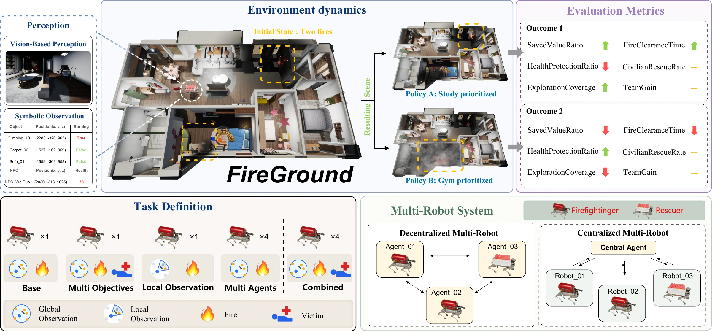

# FireGround

**Benchmarking Embodied Decision-Making in Dynamic Residential Fires**

[Project Website](https://zuwq.github.io/FireGround/) · [Dataset](https://huggingface.co/datasets/EMAS4Rescue/FireGround) · [Download Simulator][simulator] · [Quick Start](#quick-start)



*Figure 1. Two rooms are on fire. Should the robots reach the study or the gym first? Both runs start with the same fires and show how that choice affects property damage and civilian health.*

## Abstract

Dynamic embodied environments such as residential fire scenarios challenge agents to interpret evolving visual observations and act promptly as hazards evolve. We introduce FireGround, an Unreal Engine 5 benchmark coupling local visual perception, fire suppression, and civilian evacuation in 3D residential environments. Smoke and illumination changes affect observations, suppression alters fire progression, and civilian health deteriorates with exposure, requiring agents to balance information gathering with timely intervention. Its five tasks vary observation scope, rescue objectives, and robot teams, with metrics tailored to these challenges. We also introduce FireAgents, a standardized agent architecture supporting symbolic and visual observations under single-robot and centralized or decentralized multi-robot control. Evaluations of proprietary and open-source foundation models reveal lower performance under visual observations in several settings and difficulties translating broader exploration into better outcomes. Benefits from perception assistance and additional robots depend on task objectives and control structure. Together, FireGround and FireAgents support systematic evaluation of perception, reasoning, and action in dynamic embodied environments.

## Quick Start

### 1. Download the Simulator

[Download the Unreal Engine simulator for Linux (approximately 2 GB)][simulator] and extract the archive. In a Bash terminal, set `UE_ROOT` to the extracted directory that contains `TongSim_Lite/`. The second command prints a confirmation when it finds the executable.

```bash
export UE_ROOT="/absolute/path/to/extracted/Linux"
test -x "$UE_ROOT/TongSim_Lite/Binaries/Linux/TongSim_Lite-Linux-Shipping" && echo "Simulator found"
```

The demo launcher loads the bundled scene configuration into a temporary copy of the simulator, starts UE automatically in offscreen mode, and closes it when the run finishes. Keep enough free disk space for an extra copy of the extracted build if your filesystem cannot share the copied data through reflinks.

### 2. Set Up the Environment

Use Linux x86-64 and Python 3.12. In the same terminal, clone the repository and install the Python dependencies. If you already have a checkout, start at the repository root with the virtual environment command.

```bash
git clone https://github.com/ZUWQ/FireGround.git
cd FireGround
python3.12 -m venv .venv
source .venv/bin/activate
python -m pip install -r requirements.lock
python -B tools/run_episode.py --check-only
```

The last command checks the Python imports and the bundled demo configuration offline. Look for `passed offline preflight` in the terminal. To run the simulator in the next step, use a regular user account on a machine with a Vulkan-capable GPU and keep local port `5726` free.

### 3. Run the Firefighting Demo

In this demo, one firefighting robot uses local text observations to respond to a residential fire. Use a fresh output directory outside the simulator build for each run.

#### Check that the simulator works

Start here to verify the scene and ignition without a model or API key.

```bash
python -B tools/run_episode.py --check-fire \
  --ue-root "$UE_ROOT" \
  --output-dir ./runs/fire-check
```

The launcher waits for the two civilians to appear, starts the fire, and counts burning objects after five seconds. A successful check prints `"status": "passed"`, with `burning_before` equal to zero and `burning_after_preburn` greater than zero. The same result is saved in `runs/fire-check/ignition.json`.

#### Run the agent

Choose a model and endpoint from your OpenAI-compatible Chat Completions provider. Replace the two placeholders below, then enter your API key at the prompt. This run sends observations to the model and may incur provider charges.

```bash
export OPENAI_BASE_URL="https://your-provider.example/v1"
export OPENAI_MODEL="your-model-id"
read -rsp "Model API key: " OPENAI_API_KEY
echo
export OPENAI_API_KEY

python -B tools/run_episode.py \
  --ue-root "$UE_ROOT" \
  --output-dir ./runs/demo-001
```

The launcher starts a fresh scene and gives the robot 300 seconds to act after ignition and the five-second preburn. At completion it prints the run ID and the counts of model calls and physical actions. Open `runs/demo-001/evaluation/summary.json` for the episode summary or `runs/demo-001/evaluation/world_states.jsonl` to follow the trajectory over time.

## Optional: Score a Completed Run

To compute the four benchmark metrics for the demo, supply the matching reference trajectory in which the fire burned without intervention. The scorer expects reference run `20261113_234218_892581_772a5a1a`. Set `--baseline` to the separately obtained directory containing that run’s `scene_config.json` and `evaluation/`.

```bash
python -B tools/score_episode.py \
  --episode ./runs/demo-001 \
  --baseline /path/to/reference-run
```

## Website Development

The [project website source](web/) uses React and Vite. From the repository root, start a local development server with Node.js 22.

```bash
cd web
npm ci
npm run dev
```

To preview the production site locally, run `npm run build` followed by `npm run preview` in the same directory. GitHub Pages publishes `web/dist/` when changes reach `main`.

[simulator]: https://drive.google.com/file/d/142bx8gi3KW1_9uYDwlMmb3jAImTkM21g/view?usp=drive_link
